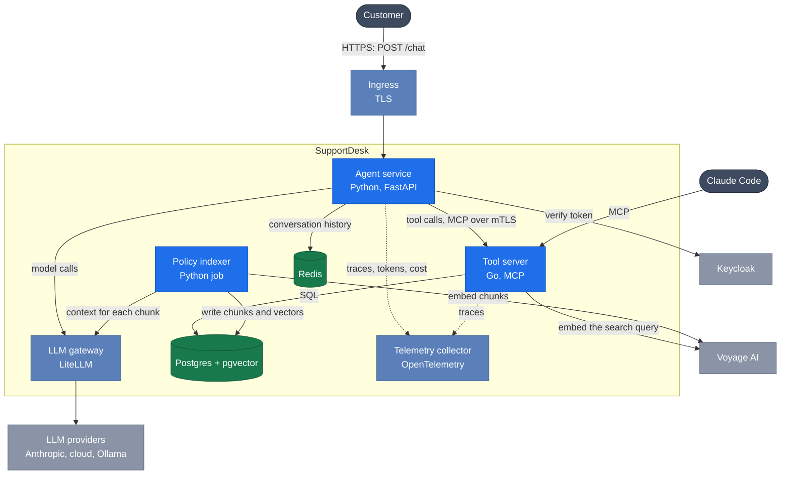

# SupportDesk

A multi-agent customer-support assistant for **ShopCo**, a fictional online shop, built on
Claude. A customer writes one message, often with several questions in it. SupportDesk:

1. works out each separate concern;
2. looks up the customer's account and orders;
3. finds the relevant shop policies;
4. takes safe actions, such as a small refund;
5. replies once, citing a policy for every point.

Anything risky, such as a refund over $500, goes to a human with a ready-made handoff.

It's the capstone project of a 16-week AI Engineer / FDE prep plan. The phase-by-phase spec
is in [`docs/SPEC.md`](docs/SPEC.md).

## Architecture (target)

> **The model proposes, code disposes.** Claude decides what to try. Plain code decides what
> is allowed. Anything that moves money or shows customer data is checked in the tool
> server, not in a prompt.



Blue: we write it. Steel blue: off-the-shelf infrastructure. Green: stores data. Grey:
outside systems.

| Part | What it does | Keeps data |
| --- | --- | --- |
| **Agent service** (Python) | The front door and the thinking. It checks the login, then a *coordinator* splits the message into concerns. Specialist agents (account, policy, reply writer) run in parallel, each with its own tools. The reply streams back. It can't act on its own: every action is a tool call. | No |
| **Tool server** (Go, MCP) | The only part that touches business data. It offers 4 tools: `get_customer`, `lookup_order`, `search_policies`, `issue_refund`. Before any refund it runs the *gates*: the customer is verified, owns the order, and the amount is at most $500 and still refundable. Over $500, it writes a handoff for a human instead. | No (uses Postgres) |
| **Postgres + pgvector** | Source of truth: customers, orders, refunds, handoffs, and policy chunks stored with vectors for search by meaning and by keyword. | **Yes** |
| **Redis** | Chat history between requests, and rate limits. It's fine to lose. | Short-lived |
| **LLM gateway** (LiteLLM) | One door for every model call. It holds the keys, sets per-team budgets, and falls back to another provider or to local Ollama. | Usage only |
| **Policy indexer** | When policies change, cuts them into chunks, adds a line of context to each with Claude, embeds them with Voyage AI, and stores them in Postgres. | No |
| **Telemetry** | A trace for every model and tool call, with tokens, cost and latency. | Traces |

How one message flows:

1. The customer's ID comes from the login token, never from the chat.
2. The coordinator records the concerns.
3. The account and policy agents run side by side and call tools through the tool server,
   where the gates run.
4. The reply writer turns their findings into one cited answer.

The full C4 views (context, containers, components, a sequence diagram) are in
[`docs/ARCHITECTURE.md`](docs/ARCHITECTURE.md).

## Status

- **Week 1 done** (SD Phases 0–1): the project skeleton, CI, fixture data, and the 4 tools
  in Python with tests.
- **Week 2 in progress** (SD Phase 2): the model client interface and a fake client for
  tests are done. The agent loop is being written.
- Everything else in the diagram is still to come; see the spec for the order.

## Quick start

```bash
uv sync                      # create .venv with the pinned Python (3.13) and all deps
cp .env.example .env         # add ANTHROPIC_API_KEY (needed from week 2)
uv run supportdesk           # http://127.0.0.1:8000/health and /tools, docs at /docs
```

Or with Docker: `docker compose --profile full up --build` (also starts Postgres with
pgvector and Redis, used from week 4).

## Checks (the same ones CI runs)

```bash
uv run ruff check . && uv run ruff format --check . && uv run pyright && uv run pytest
```

## Layout

```
src/supportdesk/
  __main__.py        entry point: `uv run supportdesk` / `python -m supportdesk`
  main.py            FastAPI app: GET /health, GET /tools
  config.py          Settings from env / .env (pydantic-settings)
  domain.py          Customer, Order, Refund, PolicyDoc ... (pydantic, frozen)
  repository.py      Repository protocol + in-memory JSON implementation
  agent/
    client.py        ModelClient protocol + AnthropicClient (the real SDK)
    loop.py          run_agent_loop: call model -> run tools -> repeat
  data/*.json        fixtures: 6 customers, 15 orders, 2 refunds, 6 policy docs
  tools/
    base.py          Tool wrapper, ToolContext, ToolResult, ToolError
    account.py       get_customer, lookup_order
    policies.py      search_policies (naive keyword search, replaced in week 4)
    refunds.py       issue_refund
    registry.py      ToolRegistry: definitions for Claude + dispatch by name
tests/               pytest, no network calls
  fakes.py           FakeClient + reply()/text()/tool_use() builders for scripted model replies
```

## Tools

| Tool | What it does | Errors (returned as data) |
| --- | --- | --- |
| `get_customer` | Profile, tier, loyalty points | `customer_not_found`, `invalid_input` |
| `lookup_order` | Order, items, status, dates, notes, refunded and refundable amounts | `order_not_found`, `invalid_input` |
| `search_policies` | Top-k policy sections with citations (`POL-RETURNS §1`) | `invalid_input`; no match is an empty list |
| `issue_refund` | Records a refund for a delivered or returned order | `order_not_found`, `order_not_refundable`, `amount_exceeds_refundable`, `invalid_input` |

Each tool is a plain function plus a definition (`name`, `description`, `input_schema`)
whose JSON schema is generated from a pydantic model, so what Claude sees and what the
code validates can't drift apart. `curl localhost:8000/tools` shows exactly what the model
will get.

Verification, ownership and the 500 USD handoff limit are **not** enforced yet. They are
SD Phase 5 gates, enforced in code in the Go MCP server.

## Fixture edge cases (used by later phases)

| Order | Case |
| --- | --- |
| O-5003 | Shipped, not delivered: "Where is my order?" (week 2 smoke prompt) |
| O-5007 | Tablet, slow delivery: the 3-concern sample message (week 5) |
| O-5009 | Delivered 31 days before 2026-10-20, one day past the return window |
| O-5010 | Partially refunded already (18.00 of 82.00) |
| O-5011 | 900 USD laptop, which must become a handoff (week 6) |
| O-5013 | `notes` contains a prompt injection (trap #6) |
