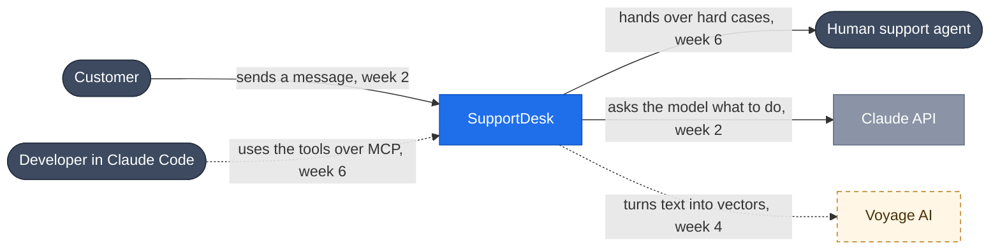
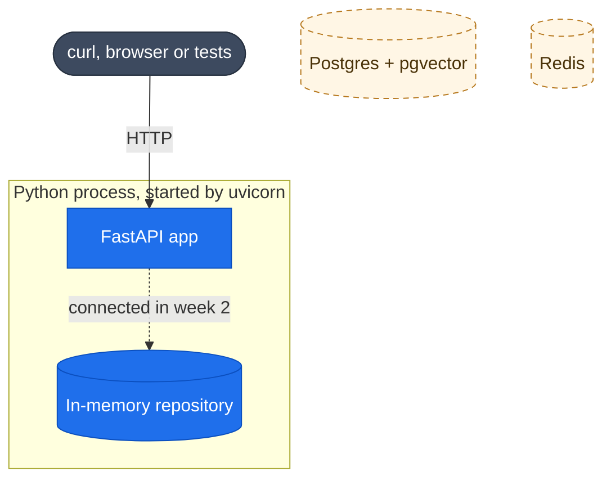
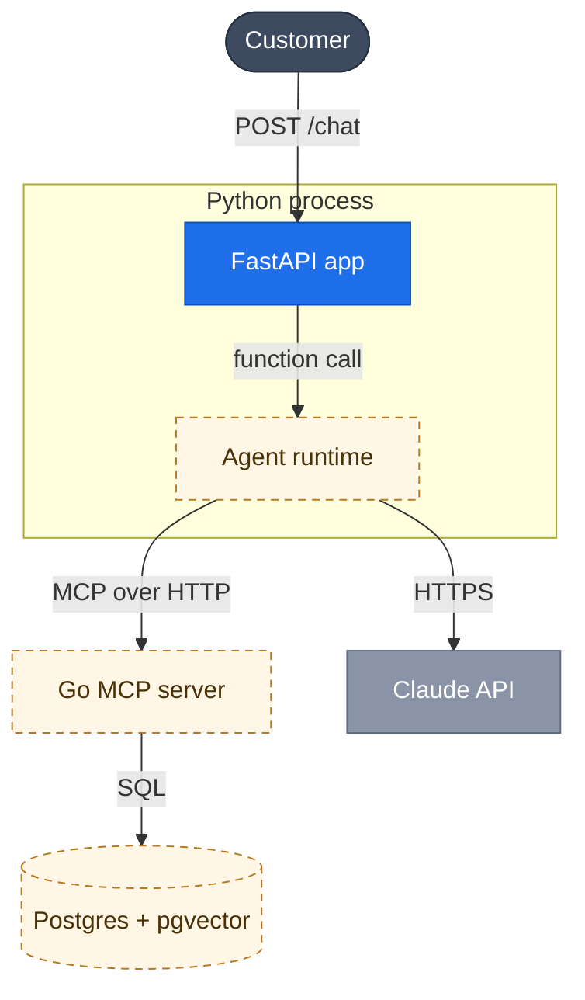
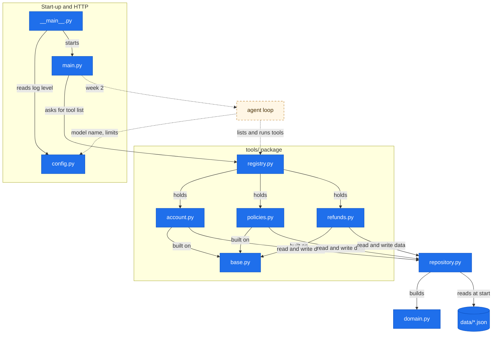
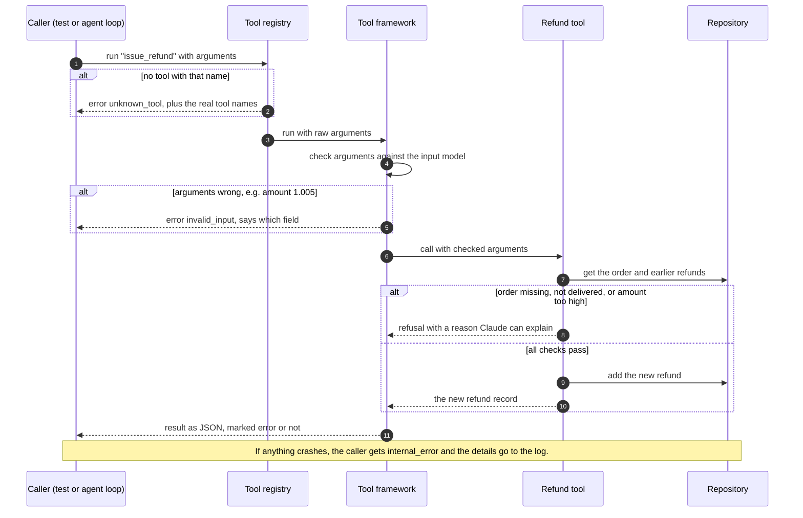

# SupportDesk architecture

This document describes the app at four [C4](https://c4model.com) zoom levels, from the
outside world down to single Python files. Each level zooms into one box from the level above.
After each diagram, every box has a short description: what it does, what it calls, what calls
it, and whether it keeps any data.

**Status:** as of week 1. Solid blue boxes are built and tested. Dashed amber boxes are
planned, with the week they arrive. Grey boxes are outside systems or people.

> The rule for the whole project: **the model proposes, code disposes.** Claude suggests what
> to do. Plain code decides what is allowed, especially anything that moves money or shows
> another customer's data.

---

## Level 1 · System context

At this zoom, all of SupportDesk is one box. The diagram shows who uses it and which outside
services it depends on. Most arrows are still planned. Today the only callers are the tests
and curl, through `/health` and `/tools`.

| Part | What it does | Keeps data |
| --- | --- | --- |
| **SupportDesk** (this repo) | Answers ShopCo support messages. It looks up the customer's account and orders, checks the shop's policies, takes safe actions such as small refunds, and sends one reply that cites the policy it relied on. | Yes: customers, orders, refunds, policies. In memory today, Postgres from week 4. |
| **Customer** | Writes something like "my order arrived broken, I want my money back". They never choose their own customer ID. The API layer sets it from their login, so the model can't be tricked into acting as someone else. | — |
| **Claude API** (week 2) | The "brain". SupportDesk sends it the conversation and the list of tools. Claude replies with text, or asks for a tool to be run. Claude never runs tools itself and can't reach the database. | No memory between calls. SupportDesk resends the whole conversation every time. |
| **Human support agent** (week 6) | Takes over when the money or the risk is too high, for example a $900 refund. They receive a handoff with 5 fields: customer, order, summary, evidence, recommended action. | — |
| **Voyage AI** (week 4) | Turns pieces of policy text into number vectors, so policies can be found by meaning rather than exact words. Anthropic has no embedding model, so this comes from another provider. | — |
| **Developer in Claude Code** (week 6) | Connects Claude Code to the same MCP server SupportDesk uses. This proves the tools work with any MCP client, not only with this app. | — |

---

## Level 2 · Containers

Zoom into the SupportDesk box. A *container* here means anything that runs separately: a
process, a database, a server. It isn't the same thing as a Docker container, although each
one usually ends up in its own Docker container.

### Today (week 1)

### Target (week 6)

### Python process (FastAPI app) · built

- **Job:** the web server.
  - Today it answers two read-only questions: "are you alive?" (`GET /health`) and "which
    tools would Claude get?" (`GET /tools`).
  - From week 2 it also runs the conversation with Claude and streams the reply back.
- **Calls:**
  - Today: nothing outside itself.
  - Week 2: the Claude API.
  - Week 6: the Go MCP server, instead of running the tools in this process.
- **Called by:** customers, curl, and the CI smoke test.
- **Keeps data:** only the in-memory repository below, which lives inside this process.
- **Runs as:** one OS process (`uv run supportdesk`, or the Docker image). Uvicorn opens the
  port, and FastAPI routes each request to a Python function.

### In-memory repository · built · stores data in RAM

- **Job:** holds the shop's data: 6 customers, 15 orders, refunds and 6 policy documents. It
  loads them from JSON files packaged with the code.
- **Keeps data:** yes, in memory only. New refunds are added to a Python list, so a restart
  forgets them and the data resets to the JSON files. That's fine for development and tests,
  and it's why Postgres arrives in week 4.
- **Today:** only the tests create one. The running app will create one at startup in week 2,
  when `/chat` first needs a tool.

### Postgres + pgvector · week 4 · stores data on disk

- **Job:** the real database. It will hold orders, refunds and *policy chunks*: pieces of
  policy text stored with their vectors, so they can be searched by keyword and by meaning.
- **Today:** starts with `docker compose up` (service `db`), but no code connects to it yet.
- **Called by:** the Python repository in week 4, then the Go MCP server in week 6.

### Redis · later · short-lived data

- **Job:** reserved for short-lived data: chat sessions, rate limits, caching.
- **Today:** it's in `compose.yaml` so the setup is ready, but the spec doesn't use it until
  production hardening.

### Agent runtime · weeks 2–5

- **Job:** the loop that talks to Claude. It sends the conversation, runs any tools Claude
  asks for, sends the results back, and repeats until Claude is done.
  - From week 3 the loop is split into specialists: account, policy, and reply writer.
  - From week 5 a coordinator decides which specialists to run.
- **Calls:** the Claude API, and the tools (in-process now, over MCP from week 6).
- **Keeps data:** only the current conversation, for the length of one request.

### Go MCP server · week 6

- **Job:** takes over the 4 tools from Python. More importantly, it holds the *gates*:
  - is the customer verified?
  - do they own this order?
  - is the refund over $500?

  A separate process is a hard wall. However the model is tricked, it can only call tools,
  and the tools say no.
- **Calls:** Postgres.
- **Called by:** the agent runtime and Claude Code.
- **Keeps data:** no. Its data lives in Postgres.

---

## Level 3 · Inside the Python process

Zoom into the Python process that exists today. Each box is one file under `src/supportdesk/`.
An arrow means "imports and calls".

Arrows only point down: lower files never import higher ones. That means you can swap the
bottom (storage) or add to the top (the agent loop) without touching the middle.

### Start-up and HTTP

| File | What it does | Calls | Called by | Keeps data | In Go terms |
| --- | --- | --- | --- | --- | --- |
| `__main__.py` | The "on" switch. Runs when you type `uv run supportdesk` or `python -m supportdesk`. Reads the log level and starts the web server. | `config.py`; uvicorn, which loads `main.py` by name | You, from the terminal. The Docker image calls uvicorn directly. | No | `cmd/supportdesk/main.go` |
| `main.py` | Defines the URLs. `GET /health` returns `{"status": "ok"}` so Docker and CI can see it's alive. `GET /tools` returns the exact tool definitions Claude will see. | `tools/registry.py`, built once and reused | Uvicorn, for every request | No. It only caches the registry, which is a fixed list of tools. | `http.ServeMux` plus handlers. `Depends` is per-request dependency injection, where Go would use a closure. |
| `config.py` | Reads settings from environment variables or `.env`: API key, model, max agent steps, log level. A bad value stops the app at startup. The API key never prints in logs. | Nothing: it only reads the environment and `.env` | `__main__.py` today; the agent loop from week 2 | No | `envconfig.Process` into a struct, in `sync.Once` |

### Tools: what Claude is allowed to do

| File | What it does | Calls | Changes data | In Go terms |
| --- | --- | --- | --- | --- |
| `tools/registry.py` | The one list of all tools. Gives the definitions (name, description, input format) sent to Claude. Runs a tool by name. An unknown name returns an error that lists the tools that do exist. | The four tools | No | `map[string]Tool` plus `Run(ctx, name, rawJSON)` |
| `tools/base.py` | Shared machinery for all tools: (1) builds the definition from a pydantic model, so what Claude sees always matches what the code accepts; (2) checks Claude's arguments; (3) runs the tool and returns JSON; (4) turns every error, even a crash, into data. Also defines `ToolContext`: the repository plus the current time. Tests freeze the time. | The tool's handler; logging | No | A generic `Tool[In]` whose `Run` uses `recover()` |
| `tools/account.py` | `get_customer`: profile, tier, loyalty points. `lookup_order`: an order with items, status, dates, and the already-refunded and still-refundable amounts. Its description tells Claude that order notes are customer data, not instructions. | Repository | Never | Handler funcs over a `Repository` interface |
| `tools/policies.py` | `search_policies`: finds matching policy sections and returns citations such as `POL-RETURNS §2`. Today it's simple keyword matching. No match returns an empty list, so Claude can say "I don't know" instead of inventing a policy. Week 4 replaces it with keyword-plus-meaning search; the name and output stay the same. | Repository | Never | `strings.Fields` + score map + `sort.Slice` |
| `tools/refunds.py` | `issue_refund`: the only tool that changes anything. Before writing, it checks that the order exists, was delivered or returned, and that the amount is positive, in whole cents, and no more than what's left after earlier refunds. If any check fails, nothing is written. **Not yet checked:** customer verification, order ownership, the $500 limit. Those come in week 6, in the Go server. | Repository (read, then add the refund) | **Yes** | A handler with guard clauses, then `repo.AddRefund` |

### Data

| File | What it does | Calls | Called by | Keeps data | In Go terms |
| --- | --- | --- | --- | --- | --- |
| `repository.py` | The only place that knows where data lives. The `Repository` interface lists the operations: get customer, get order, list policies, refunds for an order, add refund, next refund ID. `InMemoryRepository` reads the JSON once and keeps everything in dictionaries. Week 4 adds a Postgres version, and no tool changes. | `domain.py`, `data/` | All tools (via `ToolContext`), tests | **Yes, in RAM** | `type Repository interface{…}` + a `memRepo` struct with maps |
| `domain.py` | Defines Customer, Order, OrderItem, Refund and Policy, with built-in rules: ID patterns (`C-1001`), exact decimals for money (never floats), timezone-aware timestamps, no unknown fields (so a typo in a JSON file fails loudly), and no changes after creation. | Nothing: this is the bottom layer | Repository, tools | No (definitions only) | Structs + validation + `DisallowUnknownFields` |
| `data/*.json` | The made-up shop: 6 customers, 15 orders, 2 earlier refunds, 6 policy docs. Some orders are traps on purpose: O-5009 is one day past the return window, O-5011 is $900, O-5013 has a fake "SYSTEM:" note, O-5010 is partly refunded. These files ship inside the installed package, so Docker finds them too. | — | Repository, once at startup | The source data | `embed.FS` |

---

## Level 4 · One refund request, step by step

This is what happens in the code when someone asks for a refund. Today a test plays the
caller. From week 2 the agent loop does, every time Claude replies "please run `issue_refund`
with these arguments".

Every path ends with a result handed back. No path throws an exception at the caller, so the
conversation with Claude never breaks.

---

## Where new parts plug in

| Week | New part | Connects to |
| --- | --- | --- |
| 2 | Agent loop, a fake Claude client for tests, `POST /chat` with streaming, token and cost logs | Gets the tool list from the registry and runs tools through it. Reads the model name and step limit from settings. |
| 3 | Specialist agents (account, policy, reply writer), strict structured results, prompt caching | Each specialist gets its own small registry with only its tools. |
| 4 | Postgres repository, search by meaning plus keywords | A second implementation of the repository interface, and a new engine behind `search_policies`. |
| 5 | Coordinator that splits a message into concerns and runs specialists in parallel | Sits above the specialists. |
| 6 | Go MCP server with the safety gates and the 5-field handoff | Replaces the Python tools. The registry turns into an MCP client. |
| 7–8 | Evals and trap tests, a version built on the Agent SDK | Both run against `POST /chat` and are scored side by side. |

Keep this file up to date as each week lands. Turn amber boxes blue, and add new boxes.
